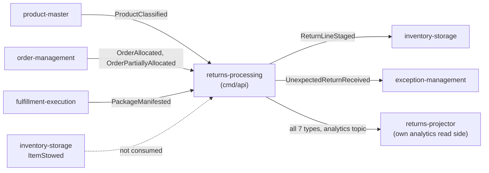

# Integration

How `returns-processing` fits with the rest of the warehouse-systems fleet, with the **status of
every edge**. Three words are used strictly:

- **Built**: code in this repository that does the job.
- **Verified**: the other side was read on its own `origin/develop` ref in the local checkout
  (refs as they stood on 2026-11-01, not re-fetched for this page) and matches the string or
  constant used here.
- **Absent**: no code on either side.

The context's boundary rule is hard: **it never makes a REST, MCP or A2A call to a sibling
context.** Cross-context data arrives as Kafka events that are applied to local copies, and its
own facts leave as Kafka events ([ADR 0003](/docs/adr/0003-local-copies-and-consumed-contracts),
and the fleet rule in `.claude/rules/fleet/context-boundaries.md`). The only outbound network
connections of any binary are Postgres and Kafka. All Kafka traffic is CloudEvents 1.0 in
structured mode on the shared broker, and every REST, MCP and A2A surface is unauthenticated.

## Edge map

Source: `internal/adapters/inbound/kafka/{product_classes,allocated_lines,manifests,analytics_consumer}.go`
(consumed topics and types), `internal/adapters/outbound/kafka/encoder.go` (published topics and
types), `cmd/api/consumers.go` (the three consumers), and the neighbours' code on their
`origin/develop` (`product-master` and `order-management` and `fulfillment-execution`
`internal/adapters/outbound/kafka/`, `inventory-storage` `internal/adapters/inbound/kafka/return_line_consumer.go`,
`exception-management` `internal/adapters/inbound/kafka/returns_consumer.go`). The dotted edge
does not exist: no code in this repository consumes `ItemStowed`.

## Upstream: events this context consumes

Three consumers run inside `cmd/api`, each in its own goroutine with its own consumer group taken
from a **required** environment variable (the process refuses to boot without all three). Each
decodes CloudEvents 1.0 only, dispatches on the **full** `type`, and feeds a local copy through a
use case that claims the CloudEvents `id` and applies the copy in one unit of work.

| Producer | Topic | Full `type` | Effect here | Group variable |
| --- | --- | --- | --- | --- |
| product-master | `warehouse.product-master.events` | `com.warehouse.wms.product-master.product.ProductClassified` | Upsert the SKU's handling tags, temperature class and DOT hazard class into the classification copy (only a newer `version` changes it) | `PRODUCT_CLASSIFICATION_CONSUMER_GROUP` |
| order-management | `warehouse.order-management.events` | `com.warehouse.wes.order-management.order.OrderAllocated` and `...order.OrderPartiallyAllocated` | Record each allocated line (order id, line number, SKU) in the allocations copy | `ORDER_LINES_CONSUMER_GROUP` |
| fulfillment-execution | `warehouse.fulfillment.events` | `com.warehouse.wes.fulfillment-execution.package.PackageManifested` | Split `order_ref` (`{order_id}-line-{line_no}`) and record the package and the event time in the manifested copy | `MANIFEST_CONSUMER_GROUP` |

Every other type on those three topics is ignored. The allocated lines carry **no quantity**, so
the authorized quantity is capped by the disposition policy only (see the
[Context map](/docs/ddd/context-map)). `AuthorizeReturn` reads the allocations and manifested
copies, and `InspectReturnLine` reads the classification copy.

### Failure behaviour

From `internal/adapters/inbound/kafka/{consumer,kafka,deadletter}.go`:

- A message that is not a valid CloudEvents 1.0 event is logged at WARN and committed past. So is
  a valid event of a type the consumer has no handler for.
- A payload that cannot be decoded, or that can never be applied (empty SKU, an `order_ref` that is
  not the work-unit formula, a classification without a `version`, an event without an `id`), is
  dead-lettered at once, without retries.
- A transient failure (database down, unit of work rolled back) retries the same message with a
  backoff that starts at 200 ms, doubles and is capped at 5 s, for at most five attempts
  (`maxHandlerAttempts`). Then the message goes to `<topic>.dlq` with the `x-dlq-source-topic`,
  `x-dlq-source-partition`, `x-dlq-source-offset`, `x-dlq-error` and `x-dlq-failed-at` headers.
- The offset is committed only after success or after a successful dead-letter publish. Both the
  dead-letter publish and the commit are retried until they work, so a message is never dropped
  silently. A cancelled context (shutdown) is never dead-lettered: the message is redelivered on
  restart.
- A group without a committed offset starts at the first offset, so a fresh deployment replays the
  whole topic and the copies converge.
- Replays are safe: the `id` claim and the copy write share one transaction, and a stale
  classification `version` changes nothing.
- A broker that is unreachable or a topic that does not exist yet never blocks boot: the reader
  logs `kafka reader error; retrying` at ERROR and keeps trying. `GET /readyz` answers `503`
  naming `kafka` while the broker is unreachable.
- If a reader fails outright, the consumer stops and the composition root shuts down in its
  normal order and exits non-zero, so the orchestrator restarts the pod instead of serving on with
  a frozen copy.

What a missing copy does at request time: an order line that is not in the allocations copy is
refused (`ErrOrderLineNotAllocated`, `404`); a line with no manifested work unit is rejected by
the domain (`ErrLineNotManifested`); a SKU with no classification stays unclassified, so grading
falls to the `*` default rule. See [Troubleshooting](/docs/operations/troubleshooting).

**Status.** Built. Verified for all three producers: each topic constant matches
(`warehouse.product-master.events`, `warehouse.order-management.events`,
`warehouse.fulfillment.events`), and the full `type` strings match for `OrderPartiallyAllocated`
and `PackageManifested`; for `ProductClassified` the producer's `apis/asyncapi.yaml` declares the
same string and its CloudEvents subdomain segment is `wms`.

## Downstream: events this context publishes

Every domain event is written to the outbox in the same transaction as its aggregate and relayed
to **two** topics under the same CloudEvents `id`, `type`, `subject` and payload; only the
`dataschema` stream segment differs. The Kafka key and the `subject` are the aggregate id,
`source` is `/warehouse/returns-processing`, and the types are
`com.warehouse.wms.returns-processing.<entity>.<EventName>`.

| Entity segment | Event names | Integration topic | Analytics topic |
| --- | --- | --- | --- |
| `returnauthorization` | `ReturnAuthorized`, `ReturnAuthorizationRejected` | `warehouse.returns-processing.events` | `warehouse.returns-processing.analytics` |
| `returnreceipt` | `ReturnReceiptOpened`, `ReturnLineInspected`, `UnexpectedReturnReceived` | same | same |
| `disposition` | `DispositionDecided`, `ReturnLineStaged` | same | same |

`dataschema` is `urn:warehouse:returns-processing:events:<EventName>:v1` on the integration topic
and `urn:warehouse:returns-processing:analytics:<EventName>:v1` on the analytics topic. The full
catalogue is on [Events](/docs/api-reference/events).

| Consumer | Types read | Status |
| --- | --- | --- |
| inventory-storage | `com.warehouse.wms.returns-processing.disposition.ReturnLineStaged`, the `RESTOCK` handover into its staged-receipt use case | Built + verified (`typeReturnLineStaged` in its inbound Kafka consumer) |
| exception-management | `com.warehouse.wms.returns-processing.returnreceipt.UnexpectedReturnReceived`, one problem-solve case per unexpected line | Built + verified (`TypeUnexpectedReturnReceived` in its inbound Kafka consumer) |
| `cmd/returns-projector` (this repository) | the five receipt and disposition types from the analytics topic; `ReturnAuthorized` and `ReturnAuthorizationRejected` are acknowledged and ignored | Built; see [Analytics](/docs/operations/analytics) |
| any other fleet consumer of `warehouse.returns-processing.events` | the other five types | **Absent**: none known on the siblings' `origin/develop` checkouts |

### Publishing failure behaviour

From `internal/adapters/outbound/kafka/{encoder,relay_sink}.go` and
`internal/adapters/outbound/postgres/outbox_relay.go`:

- The relay claims due rows with `FOR UPDATE SKIP LOCKED` and sends them one at a time, in id
  order, with `acks=all`. Delivery is at least once: a crash between send and commit republishes
  the row with the same persisted event id, which consumers dedupe on.
- A broker failure records the error, stops the pass and leaves the row with `attempts + 1` and a
  later `next_attempt_at`; later rows stay unpublished until the next pass.
- After `OUTBOX_MAX_ATTEMPTS` failures (default 20, `0` = unlimited) a row is excluded from claims
  and logged at ERROR; it stays in the outbox until an operator re-arms it.
- A row the encoder can never turn into a message (malformed payload, an event outside the
  published catalogue, an empty aggregate id) is poison: it goes to
  `warehouse.returns-processing.events.dlq` with a `dlq-reason` header, then is deleted, so it
  cannot block the rows behind it.
- A relay that stops makes the process exit, like a dead consumer.

Consumer-side behaviour (retries, dead letters) belongs to each consumer.

### The analytics projector

`cmd/returns-projector` reads **only** `warehouse.returns-processing.analytics`, under the group in
`ANALYTICS_CONSUMER_GROUP`, and is the only writer of the analytical database
(`ANALYTICS_DATABASE_URL`). Its failure policy differs from the three consumers above: an
unusable payload or a row the store rejects is dead-lettered at once to
`warehouse.returns-processing.analytics.dlq`, but a transient failure is retried with the same
capped backoff **without** a dead-letter limit and without committing the offset. See
[ADR 0007](/docs/adr/0007-analytics-read-side).

## Synchronous calls this context makes

**None.** There is no outbound REST, MCP or A2A client in `internal/` or `cmd/`: the only
code importing `net/http` is the inbound servers (`internal/adapters/inbound/{http,mcp,a2a}`)
and the listeners of the `cmd/` entry points. This is deliberate and stable, not a gap: a live lookup in a
sibling would make the request path depend on its availability, which the local copies exist to
avoid. If a sibling is down, the affected edge is only stale, never failing a request.

## Who calls this context

| Surface | Binary | Status |
| --- | --- | --- |
| REST commands and reads for operators and the console, see [API overview](/docs/api-reference) | `cmd/api` | Built |
| Read-only MCP server with `get_return`, `list_returns_by_order` and `get_disposition_policy`, see [MCP tools](/docs/mcp/tools) | `cmd/mcp` | Built |
| Read-only A2A agent with the skills `return_status` and `disposition_policy` ([ADR 0008](/docs/adr/0008-a2a-inbound-adapter)) | `cmd/a2a` | Built |
| Returns reports (`GET` over the analytical database) | `cmd/returns-reports` | Built; see [Analytics](/docs/operations/analytics) |
| `returns_mfe` console remote ([ADR 0006](/docs/adr/0006-console-remote-web)) | `web/` | Built; calls only this context's own REST |

None of these is a sibling context calling in with a command: the siblings only consume events.
Whether the console shell lists the remote is the console repository's concern and was not
checked here.

## Absent edges

- No REST, MCP or A2A call from this context to any sibling, ever.
- No consumer of `ItemStowed` from inventory-storage: the restock loop is deliberately left open
  ([ADR 0001](/docs/adr/0001-returns-processing-bounded-context)).
- No `quantity` on the consumed allocated lines, so no shipped-quantity check per line.
- No consumer of the integration topic other than inventory-storage and exception-management that
  could be found on the siblings' `origin/develop`.
- No authentication or API key on any surface; access control is the in-cluster boundary.
