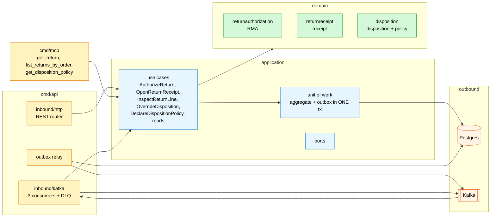

# Architecture

Hexagonal (ports and adapters), one aggregate cluster per domain package, everything else an
adapter. Only `cmd/` wires; the domain imports nothing internal but the domain
([ADR 0002](/docs/adr/0002-aggregates-and-policy)).

## Layout

```
cmd/api                 composition root: REST server, three Kafka consumers, outbox relay
cmd/mcp                 composition root: read-only MCP server (Streamable HTTP :8090)
cmd/a2a                 composition root: read-only A2A agent (JSON-RPC :8093, Agent Card)
internal/domain/        returnauthorization, returnreceipt, disposition, shared
internal/application/   use cases, ports, outbox payload, read views
internal/adapters/
  inbound/http          chi router, RFC 7807 errors, Idempotency-Key middleware, readiness
  inbound/kafka         consume loop, the three consumers, dead-letter machinery
  inbound/mcp           the three read-only MCP tools
  inbound/a2a           the two read-only A2A skills: return_status, disposition_policy
  kafka/cloudevents     the ONE CloudEvents build/decode helper
  outbound/postgres     repositories, local copies, outbox + relay, unit of work, migrations
  outbound/kafka        CloudEvents encoder, acks-all writer, relay sink
  outbound/memory       test doubles only — no cmd/** imports them (fitness-tested)
features/               godog/Gherkin acceptance scenarios (no Go files at the repo root)
migrations/             embedded, idempotent (golang-migrate), run at boot
apis/                   openapi.yaml + asyncapi.yaml — the contracts CI lints (Spectral)
```

## Binaries

| Binary | Serves | Runs |
| --- | --- | --- |
| `cmd/api` | REST `:8080`, the outbox relay, the three local-copy consumers | always everything; a consumer death is a process death (the pod restarts rather than serving on frozen copies) |
| `cmd/mcp` | MCP over Streamable HTTP `:8090` (`MCP_ADDR`), open `GET /healthz` | read-only: no write use case, no outbox, no relay, no Kafka, no consumers |
| `cmd/a2a` | A2A JSON-RPC at `/` and `/a2a` on `:8093` (`A2A_ADDR`), Agent Card at `/.well-known/agent-card.json`, open `GET /healthz` | read-only like `cmd/mcp`, same read use cases ([ADR 0008](/docs/adr/0008-a2a-inbound-adapter)) |

All three refuse to boot without `DATABASE_URL`. There is no in-memory mode and no `*_MODE` toggle
anywhere (`TestRuntimeBinaryHasNoInMemoryAdapters`).

## Containers and components



Source: `cmd/api/adapters.go`, `cmd/api/consumers.go`, `cmd/mcp/main.go`.

## Wiring rules (fitness-tested)

- **Domain purity**: `internal/domain/**` imports nothing outside `internal/domain`.
- **Adapter isolation**: adapters never import each other; only `cmd/` wires.
- **CloudEvents one door**: every envelope is built/decoded in
  `internal/adapters/kafka/cloudevents`; no flat envelope, no toggle
  (`TestNoEventEnvelopeToggleOrFlatEnvelope`).
- **No auth**: `TestNoAuthMiddlewareReintroduced` fails CI if auth middleware returns.
- **Outbox only**: events leave through `internal/application/outbox` + the relay; the publisher
  only inserts ([ADR 0005](/docs/adr/0005-transactional-outbox-and-relay)).
- **Relay attempt cap**: every composition root that builds a relay passes `WithMaxAttempts`
  (`TestOutboxRelaysPassAttemptCap`).
- **No Go files at the repo root**; the godog runner lives in `features/`.

## Data stores

One PostgreSQL database. Tables: the aggregates (`return_authorizations`, `return_receipts` +
`return_receipt_lines`, `dispositions`, `disposition_policies` — append-only versions), the three
local copies (`product_classes`, `allocated_lines`, `manifested_units`), and the machinery (`outbox`,
`processed_events` for the id-dedupe claim, `idempotency_keys` for the REST
middleware). Kafka holds no state for this service: topics are auto-created on first write; the
consumers' committed offsets are the only consumer-side state.

(ADR 0003 names the local-copy tables by their model names — "the
`product_classifications` copy" and so on; the physical tables above are what
migration 0001 creates.)

Source: `migrations/0001_returns-processing.up.sql`, `migrations/0002_idempotency_keys.up.sql`,
`internal/adapters/outbound/postgres/*.go`.
